# Mehmet Dedeler

I'm 14, making apps, simulations and tools. More at **[mehmetdedeler.com](https://mehmetdedeler.com)**.

- **[Typd](https://typd.mehmetdedeler.com)**: voice dictation that runs on your computer. Free and [open source](https://github.com/SameRainbows/typd-app).
- **Kairos**: an Android app of 6,500 sourced quotes, in closed testing on Google Play.
- **[Tally](https://tally.mehmetdedeler.com)**: counts your reps through your camera, in the browser. [Code](https://github.com/SameRainbows/Tally).
- **[Orbital](https://github.com/SameRainbows/Orbital)**: a gravity sandbox in Python.
- **[Formicai](https://github.com/SameRainbows/Formicai)**: ant colonies whose behaviour is evolved, not programmed.

Email: [mehmet@mehmetdedeler.com](mailto:mehmet@mehmetdedeler.com)

<!-- chess -->
<h3 align="center" id="play-chess-against-my-robot">Play chess against my robot</h3>

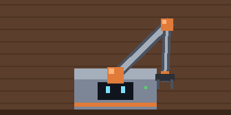 <a href="#play-chess-against-my-robot">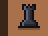</a><a href="#play-chess-against-my-robot">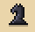</a><a href="#play-chess-against-my-robot">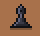</a><a href="#play-chess-against-my-robot">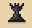</a><a href="#play-chess-against-my-robot"></a><a href="#play-chess-against-my-robot"></a><a href="#play-chess-against-my-robot">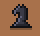</a><a href="#play-chess-against-my-robot">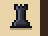</a> <a href="#play-chess-against-my-robot">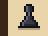</a><a href="#play-chess-against-my-robot"></a><a href="#play-chess-against-my-robot"></a><a href="#play-chess-against-my-robot">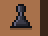</a>     <a href="chess/board/g1m0/pick/a2.md">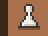</a><a href="chess/board/g1m0/pick/b2.md">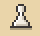</a><a href="chess/board/g1m0/pick/c2.md">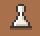</a><a href="chess/board/g1m0/pick/h2.md">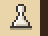</a> <a href="#play-chess-against-my-robot">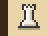</a><a href="chess/board/g1m0/pick/b1.md">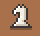</a><a href="#play-chess-against-my-robot">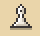</a><a href="#play-chess-against-my-robot">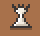</a><a href="#play-chess-against-my-robot">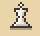</a><a href="#play-chess-against-my-robot">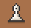</a><a href="chess/board/g1m0/pick/g1.md">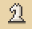</a><a href="#play-chess-against-my-robot">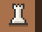</a> 

You're white. <b>Click one of your pieces</b> to move it. The robot replies in about a minute. Game 1 · move 1 · visitors 0, robot 0, draws 0

<!-- /chess -->

I'm teaching a real robot arm to play chess on a real board. This one is its pixel twin. <a href="chess/README.md">How it works</a>.

