<h3 align="center">Where should your pawn on d2 go?</h3>

Click a green square. GitHub opens an issue with your move filled in: press <b>Create</b> to play it. Click another of your pieces to pick it instead, or <a href="https://github.com/SameRainbows">go back</a>.

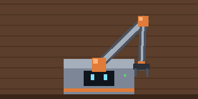 <a href="#">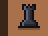</a><a href="#">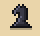</a><a href="#">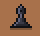</a><a href="#">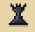</a><a href="#"></a><a href="#"></a><a href="#">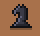</a><a href="#">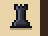</a> <a href="#">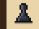</a><a href="#"></a><a href="#"></a><a href="#">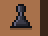</a>    <a href="https://github.com/SameRainbows/SameRainbows/issues/new?title=chess%3A%20d2d3&body=Press%20**Create**%20to%20play%20d3.%20The%20robot%20replies%20in%20about%20a%20minute%2C%20then%20closes%20this%20issue.">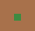</a> <a href="a2.md">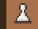</a><a href="b2.md">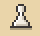</a><a href="c2.md">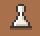</a><a href="https://github.com/SameRainbows">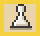</a><a href="h2.md">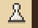</a> <a href="#">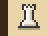</a><a href="b1.md">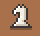</a><a href="#">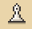</a><a href="#">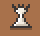</a><a href="#">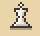</a><a href="#">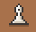</a><a href="g1.md">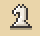</a><a href="#">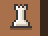</a> 

